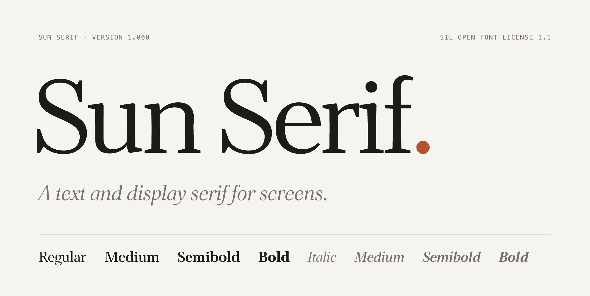
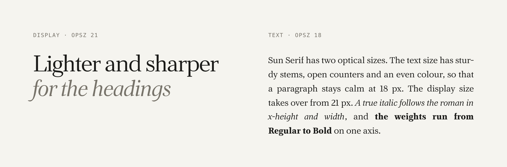
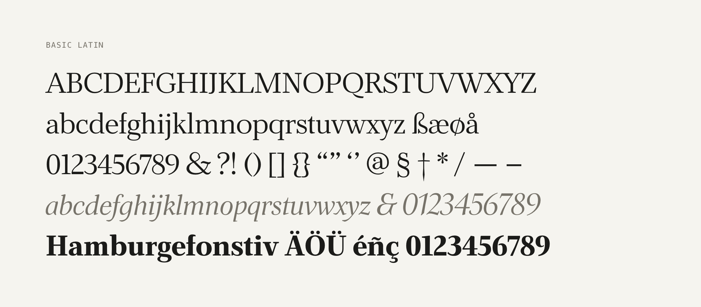
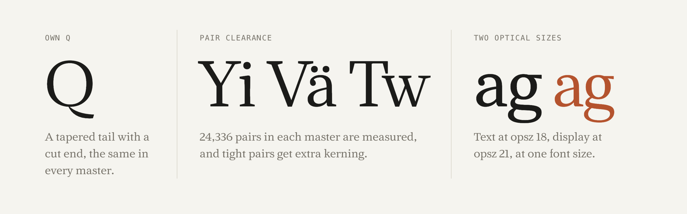

<picture>
  <source media="(prefers-color-scheme: dark)" srcset="specimen/hero-dark.png">
  
</picture>

Sun Serif is a serif type family for text and headings on screens. It has a roman and an italic variable font, each with an optical size axis and a weight axis. It was made for [yipengsun.com](https://yipengsun.com).

Sun Serif is derived from [Amstelvar](https://github.com/googlefonts/amstelvar) by David Berlow and Font Bureau. Both families use the SIL Open Font License 1.1.

<picture>
  <source media="(prefers-color-scheme: dark)" srcset="specimen/sizes-dark.png">
  
</picture>

## Use

| File | Style | Axes |
|---|---|---|
| [`SunSerif[opsz,wght].woff2`](fonts/webfonts/SunSerif%5Bopsz%2Cwght%5D.woff2) · [`.ttf`](fonts/variable/SunSerif%5Bopsz%2Cwght%5D.ttf) | Roman | `opsz` 18 to 21, `wght` 400 to 700 |
| [`SunSerif-Italic[opsz,wght].woff2`](fonts/webfonts/SunSerif-Italic%5Bopsz%2Cwght%5D.woff2) · [`.ttf`](fonts/variable/SunSerif-Italic%5Bopsz%2Cwght%5D.ttf) | Italic | `opsz` 18 to 21, `wght` 400 to 700 |

```css
@font-face {
  font-family: "Sun Serif";
  src: url("SunSerif[opsz,wght].woff2") format("woff2");
  font-weight: 400 700;
  font-style: normal;
}

@font-face {
  font-family: "Sun Serif";
  src: url("SunSerif-Italic[opsz,wght].woff2") format("woff2");
  font-weight: 400 700;
  font-style: italic;
}

body {
  font-family: "Sun Serif", Georgia, serif;
  font-optical-sizing: auto;
}
```

With `font-optical-sizing: auto`, text at 18 px or smaller uses the text size. Text at 21 px or larger uses the display size. Sizes between 18 px and 21 px interpolate.

<picture>
  <source media="(prefers-color-scheme: dark)" srcset="specimen/glyphs-dark.png">
  
</picture>

## Design

Each style has four masters: Text and Display, each in Regular and Bold. The table gives the targets of the roman in 1/1000 em.

| Target | Text | Display |
|---|---:|---:|
| x-height | 486 | 471 |
| Cap height | 671 | 696 |
| Stem, Regular | 89 | 79 |
| Stem, Bold | 159 | 157 |
| Hairline, Regular | 44 | 31 |
| Average set width per character, Regular | 470 | 436 |
| Word space | 236 | 222 |

<picture>
  <source media="(prefers-color-scheme: dark)" srcset="specimen/details-dark.png">
  
</picture>

## What differs from Amstelvar

Sun Serif is not drawn from zero. Its eight masters are locations on the parametric axes of Amstelvar (XOPQ, YOPQ, XTRA, YTLC, YTUC, YTAS, YTFI, opsz, wght, wdth). `sources/solve.py` solves these locations so that the masters reach the targets above.

| Change | Detail |
|---|---|
| Q | The Q has a new tail, a tapered blade with a cut end. The tail is a contour of five points with the same structure in all masters. |
| Word space | The word space is 222 to 236. The base design uses 318 to 319. |
| Line metrics | Ascender 1036, descender −335, line gap 0. `USE_TYPO_METRICS` is set. |
| Pair clearance | `sources/clearance.py` measures the smallest distance between the outlines of every Basic Latin and Latin-1 pair, in each master and in the base design. A pair gets extra kerning when it is closer than the base design and closer than the minimum. The minimum is 30 for text, and 34 for display at letter-spacing −0.035em. |
| `rvrn` | The base design replaces the currency signs and the oslash at heavy weights. Sun Serif removes this substitution. |

The glyph set is the Amstelvar set, 962 glyphs in the roman. The features are `kern`, `mark`, `mkmk`, `pnum` and `tnum`. Sun Serif has no small caps and no old-style figures.

## Build

```sh
uv run --with 'fonttools[woff]' python sources/build.py
```

The build downloads the Amstelvar files of commit `f44f670` and checks their sha256 values. Then it writes the fonts to `fonts/`.

| Source | Purpose |
|---|---|
| `build.py` | Builds the fonts. |
| `solve.py` | Solves the master locations from the targets. Writes `masters.json`. |
| `measure.py` | Measures x-height, stems, hairlines and set width of a font. |
| `clearance.py` | Solves, refines and checks the pair clearance. Writes `clearance.json`. |
| `qtail.py` | Draws the Q tail. |
| `family.json` | Family name, version, copyright notice and description. |

Run the clearance check after each build. The check must report no shortfall.

```sh
uv run --with 'fonttools[woff]' --with pillow --with numpy --with scipy --with uharfbuzz python sources/clearance.py check
```

To render the specimen images, install Node, Playwright and Chrome. Then run `node specimen/render.cjs`.

## Known limits

- The clearance check covers the four corner masters of each style. It does not cover the interpolated weights 500 and 600.
- The fonts are unhinted.
- The language coverage is that of Amstelvar.

## License

Sun Serif is licensed under the [SIL Open Font License 1.1](OFL.txt).

- Copyright 2016 The Amstelvar Project Authors
- Copyright 2026 Yipeng Sun (Sun Serif)
