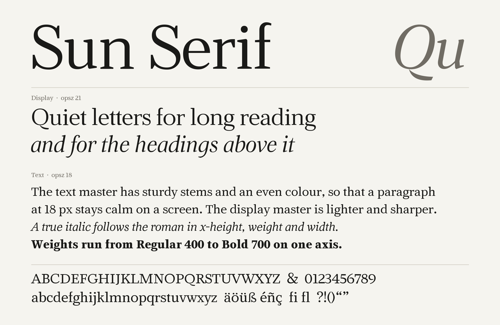

# Sun Serif

Sun Serif is a serif type family for text and display use. It has a roman and an italic variable font. It was made for the personal site [yipengsun.com](https://yipengsun.com).

Sun Serif is derived from [Amstelvar](https://github.com/googlefonts/amstelvar), a parametric variable font by David Berlow and Font Bureau. Both are licensed under the SIL Open Font License 1.1.



## Design

Each style has a Text master and a Display master, each in Regular and Bold. The Text master is for running text. The Display master is for headings.

The table gives the targets of the roman in 1/1000 em.

| Target | Text master | Display master |
|---|---|---|
| x-height | 486 | 471 |
| Cap height | 671 | 696 |
| Stem, Regular | 89 | 79 |
| Stem, Bold | 159 | 157 |
| Hairline, Regular | 44 | 31 |
| Average set width per character of a sample text, Regular | 470 | 436 |
| Word space | 236 | 222 |

## What differs from Amstelvar

Sun Serif is not drawn from zero. Its eight masters are locations on the parametric axes of Amstelvar (XOPQ, YOPQ, XTRA, YTLC, YTUC, YTAS, YTFI, opsz, wght, wdth). `sources/solve.py` solves these locations so that the masters reach the targets above.

Sun Serif also makes these changes:

1. The Q has a new tail, a tapered blade with a cut end. The tail is a quadratic contour of five points with the same structure in all masters.
2. The word space is narrower. The base design uses 318 to 319.
3. The line metrics are ascender 1036, descender −335 and line gap 0. `USE_TYPO_METRICS` is set.
4. Tight pairs get extra kerning. `sources/clearance.py` measures the smallest distance between the outlines of every Basic Latin and Latin-1 pair, in each master and in the base design at the same optical size and weight. A pair gets extra kerning when it is closer than the base design and closer than the minimum. The minimum is 30 for text at letter-spacing 0, and 34 for display at letter-spacing −0.035em.
5. The base design replaces the currency signs and the oslash at heavy weights (`rvrn`). Sun Serif removes this substitution.

The glyph set is the Amstelvar set. The roman has 962 glyphs. The features are `kern`, `mark`, `mkmk`, `pnum` and `tnum`. Sun Serif has no small caps and no old-style figures.

## Use

Both fonts have the axes `opsz` 18 to 21 and `wght` 400 to 700. The named instances are Regular, Medium, Semibold and Bold.

- `fonts/variable/SunSerif[opsz,wght].ttf`
- `fonts/variable/SunSerif-Italic[opsz,wght].ttf`
- `fonts/webfonts/SunSerif[opsz,wght].woff2`
- `fonts/webfonts/SunSerif-Italic[opsz,wght].woff2`

```css
@font-face {
  font-family: "Sun Serif";
  src: url("fonts/webfonts/SunSerif[opsz,wght].woff2") format("woff2");
  font-weight: 400 700;
  font-style: normal;
}

@font-face {
  font-family: "Sun Serif";
  src: url("fonts/webfonts/SunSerif-Italic[opsz,wght].woff2") format("woff2");
  font-weight: 400 700;
  font-style: italic;
}

body {
  font-family: "Sun Serif", Georgia, serif;
  font-optical-sizing: auto;
}
```

With `font-optical-sizing: auto`, text at 18 px or smaller uses the Text master. Text at 21 px or larger uses the Display master. Sizes between 18 px and 21 px interpolate between the two masters.

## Build

The sources are in `sources/`:

- `build.py` builds the fonts.
- `solve.py` solves the master locations from the targets and writes them to `masters.json`.
- `measure.py` measures the skeleton numbers of a font from bitmaps.
- `clearance.py` solves, refines and checks the pair clearance. It writes `clearance.json`.
- `qtail.py` draws the Q tail.
- `family.json` holds the family name, version, copyright notice and description.

Build the fonts:

```sh
uv run --with 'fonttools[woff]' python sources/build.py
```

The build downloads the Amstelvar files of commit `f44f670affec72a37c69a1bf103bddc044020f49` and checks their sha256 values.

Run the clearance check:

```sh
uv run --with 'fonttools[woff]' --with pillow --with numpy --with scipy --with uharfbuzz python sources/clearance.py check
```

## Known limits

- The clearance check covers the four corner masters of each style. It does not cover the interpolated weights 500 and 600.
- The fonts are unhinted.
- The language coverage is that of Amstelvar.

## License and credits

Sun Serif is licensed under the SIL Open Font License 1.1. See `OFL.txt`.

- Copyright 2016 The Amstelvar Project Authors
- Copyright 2026 Yipeng Sun (Sun Serif)

Amstelvar is by David Berlow and Font Bureau: https://github.com/googlefonts/amstelvar
